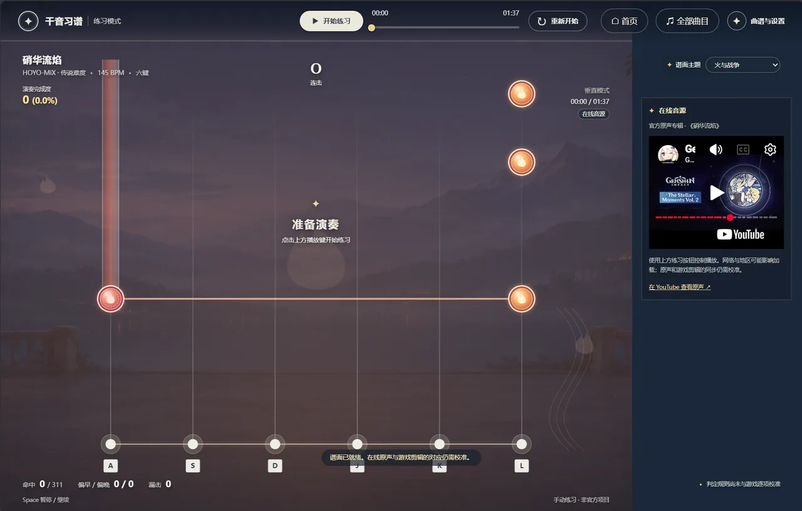

# 千音习谱 | ROMM-Trainer

[English](README.md) | [简体中文](README.zh-CN.md) | 日本語

Repertoire of Myriad Melodies Trainer

[](LICENSE)
[](https://qianyin.fun/)
[](https://qianyin.fun/)

オンラインでプレイ：[qianyin.fun](https://qianyin.fun/)

## プロジェクト紹介

千音习谱（Qianyin Xipu）は、『原神』の「千音雅集」のために作られた練習モードです。譜面を練習するためのツールを提供します。

## デモ動画

[](https://qianyin.fun/demo/qianyin-demo-v2.mp4)

<p align="center">
  
  
</p>

## 主な機能

- **再生位置の移動**：上部のシークバーをドラッグするか、左右の矢印キーまたはモバイルのボタンで 10 秒ずつ移動できます。モバイルでは現在位置から A・B 点も設定できます。移動後、その回の達成率は移動先から再計算されます。
- **練習設定**：再生速度、練習音量、ノーツの落下速度、判定範囲、タイミングのずれ、キー音量を調整できます。手動入力時には合成された弦楽器の音が鳴り、音量をゼロにすると消音できます。
- **練習フィードバック**：達成率、ヒット、コンボ、ミス、早押し・遅押しをリアルタイムで確認でき、1 回の練習終了後には結果を確認できます。ベストスコアは譜面のバージョン、区間、設定ごとに現在のブラウザへ保存されます。
- **ローカル譜面**：オリジナルのサンプル譜面を試せるほか、自分で用意した JSON 譜面と対応する音声を読み込めます。
- **区間ループ**：A–B の練習区間を指定し、ループを任意で有効にできます。ループは初期状態ではオフで、各回の開始前に短いリードインがあります。

## 声明

本プロジェクトは非営利です。チートや自動演奏ツールではなく、作品への愛から作られています。

本プロジェクトは非公式のファン作品であり、miHoYo、HoYoverse、『原神』の公式とは関係ありません。

## ライセンス

[MIT License](LICENSE)

## はじめに

Node.js 20 以降が必要です。サードパーティ製の依存パッケージをインストールする必要はありません。次のコマンドを実行し、表示されたアドレスを PC のブラウザで開いてください。

```sh
npm start
```

コア判定のテストを実行する場合：

```sh
npm test
```

初期キーは A、S、D、J、K、L で、スペースキーで一時停止・再開できます。ホーム画面ではアルバムの閲覧、お気に入りの表示、練習設定の調整ができます。楽曲詳細の下にある星を押すとお気に入りに追加できます。練習画面の譜面と設定のパネルからファイルを読み込み、練習区間を調整できます。

## デプロイ

本番サイト <https://qianyin.fun> は Cloudflare Pages で静的ファイルとしてホストされ、DNS と TLS 証明書は同じドメインの Cloudflare Zone で管理されています。

| 設定項目 | 値 |
| --- | --- |
| ビルドコマンド | `npm run build` |
| ビルド出力ディレクトリ | `build` |

`npm run build` は `dist/` を `build/` にコピーし、`deploy/` の `_headers` と `404.html` を追加します。また、スクリプト、スタイル、楽曲カタログ、譜面ファイルからバージョンを生成し、キャッシュによるページ・コード・カタログ・譜面データの不整合を防ぎます。

`main` へのプッシュ後、Cloudflare Pages が自動的にビルド・公開します。`qianyin.pages.dev` も利用できます。

## 楽曲ライブラリ

楽曲と試験譜面は公開されている[譜面リポジトリ](https://md-ndv356.github.io/genshin-rmm/zh_cn/)の資料から変換しています。現在利用できるのは伝説難度のみです。構造チェックを通過したことは、ゲーム内の譜面と一音ずつ照合済みであることを意味しません。特に変速を含む譜面と音源の同期は引き続き検証が必要です。未公開の 22 曲は一覧に状態が表示され、公式音源へのリンクが見つかっている曲は個別に試聴できます。一部のゲーム内カバー画像は [Genshin Impact Wiki](https://genshin-impact.fandom.com/wiki/Repertoire_of_Myriad_Melodies) と[公開アルバムアート集](https://www.reddit.com/r/Genshin_Impact_Leaks/comments/1wo8uxn/72_rhythm_game_new_album_arts_new_nilou/)から取得しています。一部の楽曲では代わりに[サウンドトラックのアルバムアート](https://open.spotify.com/embed/album/1FkxT3cP2litsldCdvWIM8)を使用し、その旨を画面に表示しています。

## Surasthana Fantasia（净善的遐歌）の練習

譜面と設定のパネルで「净善的遐歌 · 传说」（Surasthana Fantasia・伝説難度）を選択すると、168 BPM、231 ノーツの 6 レーン譜面を読み込めます。譜面は公開[譜面データベース](https://md-ndv356.github.io/genshin-rmm/en_us/_GMusic16/legend/)の資料から変換され、タップとホールドを含みます。

初期設定では、YouTube の公式プレーヤーで『原神』の[サウンドトラックアルバム The Stellar Moments Vol. 3](https://www.youtube.com/watch?v=2SvpviExw1o&t=2582s)を再生します。楽曲はアルバムの約 43:02 から始まります。ネットワーク、地域、プレーヤーの制限によっては再生できない場合があります。アルバム版はゲーム内の 1 分 35 秒の編集版より長く、全体の一致は未確認です。音源の開始位置は調整できますが、曲全体の同期は保証されません。楽曲を含まない 168 BPM のメトロノーム、または自分で用意したローカル音声も選択できます。ローカル音源を保存すると、調整した開始位置も現在のブラウザに保存されます。

楽曲、サウンドトラック、関連するゲームコンテンツの権利は各権利者に帰属します。本プロジェクトの MIT ライセンスは第三者のコンテンツに関する権利を付与するものではありません。

## 判定範囲

初期設定ではノーツの前後 180 ミリ秒以内の入力を受け付け、設定で前後 120～240 ミリ秒に調整できます。正確な判定の範囲は前後 55 ミリ秒のままです。ホールドは終了前の同じ範囲内で離しても完了できます。範囲外の入力にはミスと近くのノーツに対する早押し・遅押しの時間が表示されますが、追加のミス数は加算されません。範囲を変更すると現在の区間の先頭から練習が再開され、設定は端末に保存されます。

## 演奏達成率

現在選択した A–B 練習区間で獲得できる満点を 100% として達成率を計算します。本ツールの暫定的な計算では、タップまたはホールドの開始を正確にヒットすると 20 点、通常のヒットでは 10 点を獲得し、ホールド中は 1 拍につき 5 点が加算されます。途中で離しても獲得済みの点数は保持されます。譜面に BPM がない場合は 120 BPM として計算します。達成率と再生進捗は別々に表示され、ループごとに再計算されます。この採点方式はゲームとの項目ごとの照合がまだ完了していません。

## ローカル譜面の形式

譜面は UTF-8 の JSON 形式です。`laneCount` は 4 または 6、レーン番号は 0 から `laneCount - 1`、時間の単位はミリ秒です。初期キーは 4 キーが A、S、K、L、6 キーが A、S、D、J、K、L で、設定は別々に保存されます。譜面を読み込んだ後、対応音声を選択してください。[オリジナルの4キーサンプル譜面](examples/four-key-chart.json)も試せます。

```json
{
  "version": 1,
  "title": "練習セクション",
  "artist": "譜面作者",
  "durationMs": 12000,
  "bpm": 120,
  "laneCount": 6,
  "notes": [
    { "atMs": 2000, "lane": 0, "holdMs": 0 },
    { "atMs": 2500, "lane": 3, "holdMs": 1000 }
  ]
}
```

現在のバージョンは初期プロトタイプです。サンプル譜面とメトロノームはオリジナルで、判定ルールはゲームとの項目ごとの照合がまだ完了していません。楽曲の音声は同梱されておらず、ゲーム内の共有コードから譜面を読み込むことはできません。
