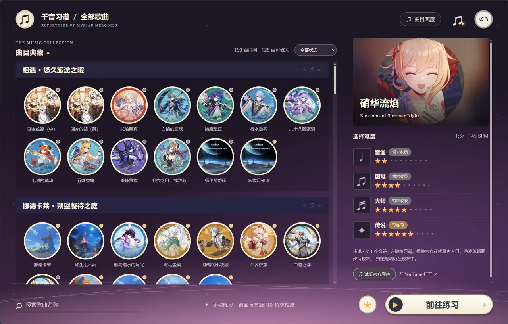
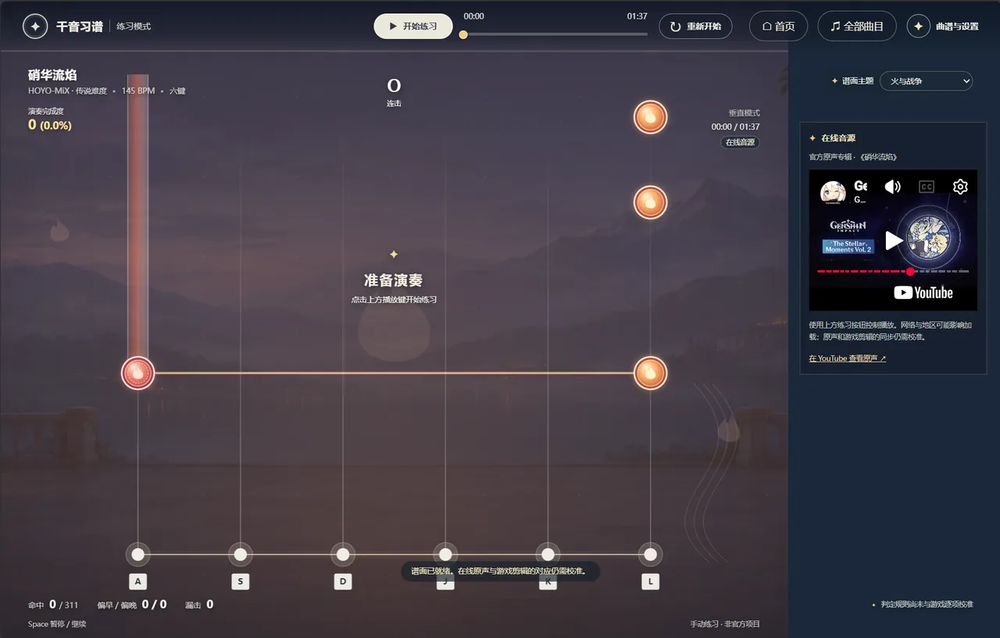

# 千音习谱 | ROMM-Trainer

English | [简体中文](README.zh-CN.md)

Repertoire of Myriad Melodies Trainer

[](LICENSE)
[](https://qianyin.fun/)
[](https://qianyin.fun/)

Play online: [qianyin.fun](https://qianyin.fun/)

## Project Introduction

Qianyin Xipu is a “Practice Mode” made for Genshin Impact’s Repertoire of Myriad Melodies, aiming to provide players with a professional score-practice tool.

## Demo Video

[](https://qianyin.fun/demo/qianyin-demo-v2.mp4)

<p align="center">
  
  
</p>

## Core Features

- **Manual practice**: Use six keyboard lanes on PC or touch the lanes on mobile, including taps, simultaneous notes, and holds.
- **Interface language**: Switch between Simplified Chinese, English, and Japanese in settings; the choice is saved in your browser.
- **Countdown**: A cancellable three-second countdown precedes starting or resuming practice.
- **Background music**: The home screen and library play the [official Dream Aria recording](https://www.bilibili.com/audio/au1659248). Use the top music button to turn it off and settings to adjust its volume; it pauses during practice and song previews. If autoplay is blocked, click the music button to start it.
- **Section looping**: Select an A–B section and optionally repeat it with a short lead-in before each attempt. Looping is off by default.
- **Seeking**: Drag the timeline or use the arrow keys or mobile buttons to seek by ten seconds. Mobile controls can also set A and B from the current position; seeking restarts scoring from that position.
- **Practice settings**: Adjust playback rate, practice audio volume, note scroll speed, hit window, timing offset, and key sound volume. Manual presses play a synthesized pluck; set the volume to zero to mute it.
- **Online playback speed**: If the player does not apply the selected rate, or its rate changes in the player, the actual rate is shown and practice restarts so timing uses the correct speed.
- **Score themes**: Choose from sixteen themes with distinct scenery, notes and manual hit effects; your choice is saved locally.
- **Practice feedback**: See live completion, hits, combo, misses, and early or late timing, then review each finished attempt. Personal bests are saved in the current browser separately for each chart version, section, and set of practice settings.
- **Home and favorites**: Start from featured songs or albums and save favorite songs in the current browser.
- **Local charts**: Try an original sample chart or import your own JSON chart and matching audio.
- **Song library**: Browse by album, filter by chart status, or search 150 titles by their Chinese, English, Japanese, or Japanese kana names, with 128 structurally checked six-lane Legendary trial charts. The remaining 22 need further source data or review.
- **Accompaniment**: The practice screen shows the current audio source. Some songs link to an official online soundtrack; unavailable online audio falls back to a metronome. User-selected local audio can be saved in the current browser and loaded again for that song without uploading it. The metronome does not contain the soundtrack; alignment with each in-game edit remains provisional.

## Statement

This project is non-profit. It is not a cheat or an auto-playing tool—purely out of love.

This is an unofficial fan project and is not affiliated with miHoYo, HoYoverse, or Genshin Impact.

## License

[MIT License](LICENSE)

## Getting Started

Node.js 20 or later is required. No third-party dependencies need to be installed. Run the following command and open the displayed address in a desktop browser:

```sh
npm start
```

Run the core judgement tests:

```sh
npm test
```

Default keys: A, S, D, J, K, L. Press Space to pause or resume. Open “Charts & Settings” at the top right to import files and adjust the practice section or key bindings. Choose a language under “语言 / Language” in settings. On the home screen, browse albums, open favorites, and adjust practice settings; select the star below a song's details to add it to your favorites.

## Deployment

The production site is served as static files by Cloudflare Pages; DNS and TLS are handled by the Cloudflare Zone for the same domain.

| Setting | Value |
| --- | --- |
| Build command | `npm run build` |
| Build output directory | `build` |

`npm run build` copies `dist/` into `build/`, adds `_headers` and `404.html` from `deploy/`, and generates a version from the scripts, styles, song catalog, and charts. The version keeps cached pages, code, catalog data, and charts in sync.

Pushes to `main` are built and published automatically; `qianyin.pages.dev` stays available as well.

## Song Library

The trial charts are converted from the public [score repository](https://md-ndv356.github.io/genshin-rmm/en_us/); only Legendary difficulty is currently available. Structural checks do not establish note-by-note parity with the game. Variable-tempo charts and synchronization still need verification. Some cover images are sourced from the [Genshin Impact Wiki](https://genshin-impact.fandom.com/wiki/Repertoire_of_Myriad_Melodies) and a [public album art gallery](https://www.reddit.com/r/Genshin_Impact_Leaks/comments/1wo8uxn/72_rhythm_game_new_album_arts_new_nilou/); songs without an identified cover use a placeholder. The 22 unavailable songs show their status in the library; songs with an identified official soundtrack can be previewed separately. Some songs use their [soundtrack album art](https://open.spotify.com/embed/album/1FkxT3cP2litsldCdvWIM8) as a labeled substitute.

## Surasthana Fantasia Trial

Open “Charts & Settings” and choose “Surasthana Fantasia · Legendary” to load the six-lane chart with 231 notes at 168 BPM. The chart is adapted from the public [score database](https://md-ndv356.github.io/genshin-rmm/en_us/_GMusic16/legend/) and contains taps and holds.

By default, the official YouTube player attempts to play the [The Shimmering Voyage Vol. 3 soundtrack album](https://www.youtube.com/watch?v=2SvpviExw1o&t=2582s), with the track starting at about 43:02. Availability depends on the network, region, and player policies. The album version is longer than the 1:35 in-game edit, and their full alignment has not been verified. You can adjust the audio start offset, but this does not guarantee synchronization throughout the song. A 168 BPM metronome without the soundtrack and a user-provided local audio file are available as alternatives.

Song, soundtrack, and game-content rights remain with their respective owners; the project's MIT license does not grant rights to third-party content.

## Hit Window

The default hit window is ±180 ms and can be adjusted from ±120 to ±240 ms in the settings. The precise window remains ±55 ms, and holds can be released within the same window before their end. Inputs outside the window receive feedback without adding an extra miss. Changing the window restarts the current section, and the setting is stored locally.

## Performance Completion

Completion is measured against the maximum possible score in the selected A–B section. In this trainer's provisional model, a precise tap or hold head earns 20 points and a good one earns 10; a held note earns 5 points per beat while held. Early release keeps already earned points. Charts without BPM use 120 BPM. Completion is separate from playback progress and resets on each loop. The scoring model has not been calibrated against the game.

## Local Chart Format

Charts use UTF-8 JSON. Times are in milliseconds and the six lanes are numbered 0–5. After importing a chart, select its matching audio file.

```json
{
  "version": 1,
  "title": "Practice section",
  "artist": "Chart author",
  "durationMs": 12000,
  "bpm": 120,
  "laneCount": 6,
  "notes": [
    { "atMs": 2000, "lane": 0, "holdMs": 0 },
    { "atMs": 2500, "lane": 3, "holdMs": 1000 }
  ]
}
```

This is an early prototype. Its sample chart and metronome are original; judgement has not yet been calibrated against the game. No song audio is bundled, and in-game sharing codes cannot be imported.
