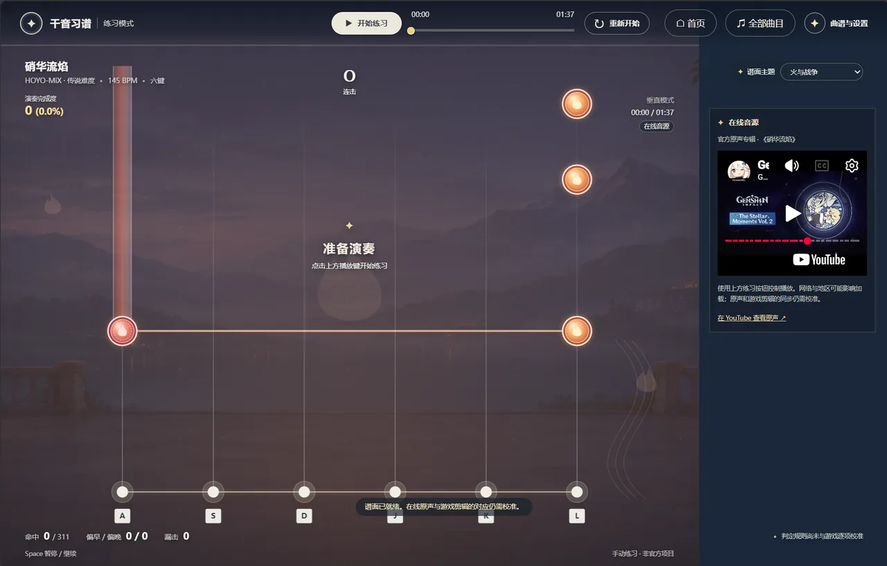

# 千音习谱 | ROMM-Trainer

[English](README.md) | 简体中文 | [日本語](README.ja.md)

Repertoire of Myriad Melodies Trainer

[](LICENSE)
[](https://qianyin.fun/)
[](https://qianyin.fun/)

在线体验：[qianyin.fun](https://qianyin.fun/)

## 项目介绍

千音习谱是为《原神》千音雅集制作的“练习模式”，旨在为玩家提供专业练谱工具。

## 演示视频

[](https://qianyin.fun/demo/qianyin-demo-v2.mp4)

<p align="center">
  
  
</p>

## 核心功能

- **进度跳转**：拖动顶部进度条，或使用左右方向键、手机快捷按钮快退或快进 10 秒；手机也可从当前位置设置 A、B 点。跳转后本轮完成度从当前位置重新计算。
- **练习设置**：调整音乐播放速度、练习音量、音符下落速度、判定范围、时间偏移和按键音量。手动按键时可听到合成琴音，音量设为零即可关闭。
- **练习反馈**：查看实时完成度、命中、连击、漏击及偏早或偏晚；完成一轮后查看结果，同一谱面版本、区间和设置的最佳成绩保存在当前浏览器。
- **本地谱面**：提供原创示范谱，也可导入自行准备的 JSON 谱面和配套音频。
- **片段循环**：设置 A–B 练习区间，循环默认关闭，可手动开启；每轮开始前保留一小段引导时间。

## 声明

本项目无盈利，非外挂、非自动演奏工具，纯粹出于热爱。

本项目为非官方作品，与米哈游、HoYoverse 及《原神》官方无隶属关系。

## 许可证

[MIT License](LICENSE)

## 运行

需要 Node.js 20 或更高版本，无需安装第三方依赖。运行以下命令后，用 PC 浏览器打开终端中显示的地址：

```sh
npm start
```

运行核心判定测试：

```sh
npm test
```

默认键位为 A、S、D、J、K、L；空格键用于暂停或继续。首页可浏览专辑、打开收藏和调整练习设置；在曲目详情下方点击星标即可收藏。练习页的「曲谱与设置」可导入文件并调整练习区间。

## 部署

正式站点 <https://qianyin.fun> 以静态文件形式托管在 Cloudflare Pages，域名的 DNS 与证书由同一账号下的 Cloudflare Zone 管理。

| 配置项 | 值 |
| --- | --- |
| 构建命令 | `npm run build` |
| 构建输出目录 | `build` |

`npm run build` 会把 `dist/` 复制到 `build/`，叠加 `deploy/` 下的 `_headers` 与 `404.html`，并根据脚本、样式、曲库目录和谱面文件生成版本号。这一步用于避免缓存导致页面、脚本、曲库与谱面数据错配。

推送到 `main` 后由 Cloudflare Pages 自动构建发布；`qianyin.pages.dev` 同时可用。

## 曲目典藏

曲目与试验谱依据[千音雅集乐谱仓库](https://md-ndv356.github.io/genshin-rmm/zh_cn/)的公开资料转换；当前仅开放传说难度。通过结构检查不等于已经与游戏逐音核对，包含变速的谱面及音源同步尤其需要继续验证。22 首未开放的曲目会在列表中显示状态，其中已找到官方原声入口的歌曲可以单独试听。部分游戏封面素材来自 [Genshin Impact Wiki](https://genshin-impact.fandom.com/wiki/Repertoire_of_Myriad_Melodies) 和[公开专辑图集](https://www.reddit.com/r/Genshin_Impact_Leaks/comments/1wo8uxn/72_rhythm_game_new_album_arts_new_nilou/)。个别曲目使用其[原声专辑图](https://open.spotify.com/embed/album/1FkxT3cP2litsldCdvWIM8)作为替代，并在界面标明。

## 《净善的遐歌》试练

打开「曲谱与设置」，选择「净善的遐歌 · 传说」即可载入 168 BPM、231 音符的六轨谱面。谱面依据[千音雅集乐谱仓库](https://md-ndv356.github.io/genshin-rmm/zh_cn/_GMusic16/legend/)的公开资料转换，包含单音和长音。

默认尝试通过 YouTube 官方播放器播放《原神》[闪耀的群星 3 原声专辑](https://www.youtube.com/watch?v=2SvpviExw1o&t=2582s)，曲目从专辑约 43:02 开始。网络、地区和播放器策略可能影响播放。该专辑版长于游戏内的 1 分 35 秒版本，目前尚未确认剪辑是否完全一致；可在设置中调整「音源起点」，但不能保证整首歌自动对齐。也可选择不含歌曲的 168 BPM 节拍伴奏，或选择自己准备的配套本地音频。

歌曲、原声及相关游戏内容的权利归其各自权利人所有；项目的 MIT 许可不授予这些第三方内容的权利。

## 判定范围

默认接受音符前后 180 毫秒内的按键，可在「曲谱与设置」中调整为前后 120–240 毫秒；准确判定仍使用前后 55 毫秒。长音在结束前的同一范围内松开仍可完成。超出范围的按键会显示未命中和附近音符的偏早或偏晚时间，不会额外增加漏击次数。调整范围会从当前片段起点重新练习，设置保存在本机。

## 演奏完成度

完成度以当前 A–B 练习区间的可得满分为 100%。本工具暂按以下规则估算：单音或长音开头准确命中得 20 分、普通命中得 10 分；长音按住时，每一拍累计 5 分。提前松开长音时，保留已经获得的分数；谱面未提供 BPM 时按 120 BPM 计算。完成度与播放进度分别显示，每轮循环重新计算。这套练习计分尚未与游戏逐项校准。

## 本地谱面格式

谱面为 UTF-8 JSON，时间单位是毫秒，六个轨道的编号为 0–5。导入谱面后，需选择自行准备的配套音频。

```json
{
  "version": 1,
  "title": "练习段落",
  "artist": "谱面作者",
  "durationMs": 12000,
  "bpm": 120,
  "laneCount": 6,
  "notes": [
    { "atMs": 2000, "lane": 0, "holdMs": 0 },
    { "atMs": 2500, "lane": 3, "holdMs": 1000 }
  ]
}
```

当前版本为早期原型：示范谱与节拍伴奏为原创；判定规则尚未与游戏逐项校准。项目不内置歌曲音频，也不支持从游戏分享码读取谱面。
